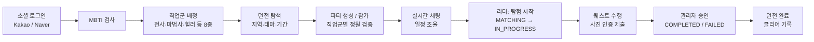
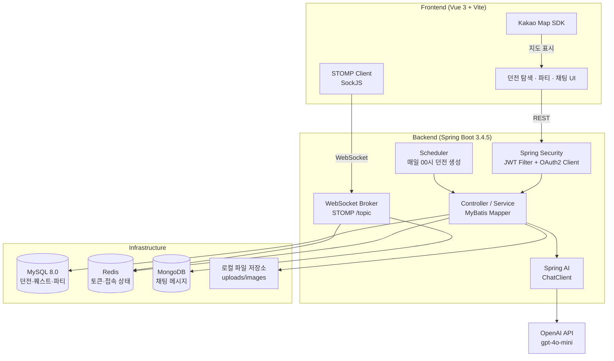

# TRAVEL QUEST


> **여행 RPG 파티 매칭 플랫폼 — "TRAVEL QUEST"**
>
> 현실 속 여행을 판타지 RPG처럼. MBTI로 직업을 정하고, 여행지를 던전으로, 여행 계획을 퀘스트로 바꿔
> 낯선 사람과 파티를 이뤄 함께 깨는 게이미피케이션 여행 플랫폼입니다.

**SSAFY 13기 관통 프로젝트 (2인) · 2025.05**

| 구분 | 내용 |
| --- | --- |
| 주제 | 여행 RPG 파티 매칭 플랫폼 |
| 인원 | 2명 (양준하 · 신승용) |
| 담당 | 백엔드 · 프론트엔드 전 영역 (도메인별 분담) |
| 핵심 구현 | 던전·퀘스트 자동 생성 파이프라인, OAuth2/OIDC 인증, WebSocket 실시간 채팅, 파티 매칭 |
| 결과물 | 웹 서비스, [ERD](docs/ERD.md) · [클래스 다이어그램](docs/ClassDiagram.md), [발표 자료](docs/250528_13기_대전_5반_관통PJT_양준하_신승용.pdf), [시연 영상](docs/TRAVELQUEST.mp4) |

---

## 📚 목차

1. [기획 배경](#-기획-배경)
2. [팀원 구성 및 역할](#-팀원-구성-및-역할)
3. [주요 기능](#-주요-기능)
4. [서비스 흐름](#-서비스-흐름)
5. [시스템 아키텍처](#-시스템-아키텍처)
6. [기술 스택](#-기술-스택)
7. [프로젝트 구조](#-프로젝트-구조)
8. [API 요약](#-api-요약)
9. [데이터 모델](#-데이터-모델)
10. [던전·퀘스트 자동 생성 파이프라인](#-던전퀘스트-자동-생성-파이프라인)
11. [구현 포인트 및 트러블슈팅](#-구현-포인트-및-트러블슈팅)
12. [실행 방법](#-실행-방법)
13. [향후 계획](#-향후-계획)

---

## 🧭 기획 배경

* **2030 MZ 세대** 중심으로 자유 여행과 혼행 수요가 늘고 있지만, 동행자를 구하는 경로는 여전히 **당근마켓, 오픈카카오톡, 여행 카페** 같은 범용 채널에 머물러 있습니다.
* 기존 여행 플랫폼(마이리얼트립, 트리플 등)은 **일정 생성과 정보 제공** 중심이라, "누구와 함께 갈지"를 해결해 주지 않습니다.
* MZ 세대는 경험 공유와 소셜, 재미를 동시에 추구합니다. → **실시간 매칭 + 게이미피케이션 + 후기 공유**를 한 플랫폼에서 제공하는 서비스가 필요합니다.
* 동행 매칭은 낯선 사람과의 약속이라 진입 장벽이 높습니다. 당근마켓처럼 **가볍게 참여 → 채팅 → 취소도 쉬운** 구조를 지향했습니다.

**해결 방식** — 여행을 RPG로 치환해 참여 동기를 낮추고, 역할(직업)을 명시해 파티 구성을 예측 가능하게 만들었습니다.

| 게임 요소 | 서비스 요소 |
| --- | --- |
| 직업 | MBTI 기반 8개 직업군 |
| 던전 | 여행지(도/광역시 단위) + 기간 |
| 퀘스트 | 여행지별 미션 (AI 생성) |
| 파티 | 동행 모집 (직업군별 정원 제한) |
| 탐사 결과 | 미션 인증 기록 |

---

## 👥 팀원 구성 및 역할

| 이름 | 담당 | 주요 구현 |
| --- | --- | --- |
| **양준하** | 백엔드 · 프론트엔드 | 던전·퀘스트 도메인 설계·구현, MySQL 저장 프로시저 기반 던전 생성, Spring AI + Spring Scheduler 기반 퀘스트 생성 자동화, Kakao Map 기반 던전 지도, 퀘스트 인증 사진 업로드·저장 |
| **신승용** | 백엔드 · 프론트엔드 | OAuth2 + OIDC 인증 설계·구현, JWT 발급·재발급, WebSocket + STOMP 기반 채팅, 파티 도메인, Redis 기반 실시간 접속 상태 관리, MBTI 검사 및 직업군 설정 |

---

## ✨ 주요 기능

구현 완료된 기능 기준입니다.

| # | 기능 | 설명 |
| --- | --- | --- |
| 1 | **소셜 로그인** | Kakao / Naver OIDC 로그인, JWT 액세스 토큰(15분) + 리프레시 토큰(14일, Redis 저장) |
| 2 | **MBTI · 직업군** | 4축 검사 문항 → MBTI 계산 → 8개 직업군 자동 매핑, 파티 모집 조건으로 사용 |
| 3 | **던전 탐색** | 시도 · 구군 · 테마 · 키워드 · 기간 조건 검색, Kakao Map 마커로 던전 위치 표시 |
| 4 | **던전 자동 생성** | 매일 00시 스케줄러가 던전 10개 생성 (기간에 따른 난이도·명소 수, 지역 랜덤 선택) |
| 5 | **퀘스트 자동 생성** | 던전에 배정된 관광지 정보를 LLM(gpt-4o-mini)에 전달해 관광지당 퀘스트 1개 생성 |
| 6 | **파티 모집 · 매칭** | 파티 생성 시 직업군별 모집 인원 지정, 참가 시 직업군·정원 검증, 리더의 강퇴 |
| 7 | **실시간 채팅** | 파티 단위 STOMP 채팅, 메시지 MongoDB 저장, Redis로 파티 접속 상태 관리 |
| 8 | **퀘스트 인증** | 사진 업로드로 인증 제출(PENDING) → 관리자 승인/반려(COMPLETED / FAILED) |
| 9 | **던전 진행 상태** | MATCHING → IN_PROGRESS → COMPLETED / FAILED, 리더가 "탐험 시작" 시 진행 상태로 전환 |
| 10 | **관리자 페이지** | 파티 목록·인증 내역 검토, 사용자 목록 조회 |

### 직업군 (MBTI 기반)

회원가입 직후 MBTI 검사를 마치면 아래 8개 직업군 중 하나로 배정됩니다. 직업군은 파티 모집 조건과 화면 표시에 사용됩니다.

| 직업군 | 성향 키워드 | MBTI | 설명 |
| --- | --- | --- | --- |
| 🛡️ **전사** | 리더십, 추진력, 책임감 | ESTJ, ENTJ | 파티의 선두에서 일정을 이끌고 추진하는 유형 |
| 🧙 **마법사** | 전략, 정보력, 계획형 | INTJ, INTP | 여행지를 분석하고 최적의 루트를 계산하는 브레인 |
| 🧝 **도적** | 즉흥, 자유, 감각적 경험 | ESFP, ISFP | 계획보다 분위기를 따라가는 감성 여행자, 숨은 명소 탐색 |
| 🧚 **힐러** | 감성, 공감, 분위기 메이커 | INFJ, INFP | 팀 분위기를 조율하고 감성적 순간을 만드는 캐릭터 |
| 🎭 **바드** | 사교성, 멀티태스킹, 조율 | ENFP, ENTP | 파티원을 연결하고 시너지를 내는 리액션 담당 |
| 🏹 **레인저** | 탐험, 체험 위주, 단독 행동 선호 | ISTP, ISFJ | 자연과 숨은 여행지를 즐기며 때로는 솔로잉도 선호 |
| 🛠 **메카닉** | 실용적, 문제 해결, 기술 활용 | ISTJ, ESTP | 여행 중 문제 상황 대처에 강한 실전파 |
| 🦊 **트릭스터** | 커뮤니케이션, 연결, 사교 | ENFJ, ESFJ | 여행지에서 새로운 인연을 만드는 데 특화된 사교성 캐릭터 |

### 화면

| MBTI 검사 | 직업 배정 |
| :---: | :---: |
|  |  |

| 던전 탐색 (지도) | 파티 목록 |
| :---: | :---: |
|  |  |

| 파티 생성 (직업군별 모집) | AI 생성 퀘스트 | 관리자 인증 검토 |
| :---: | :---: | :---: |
|  |  |  |

---

## 🔄 서비스 흐름



---

## 🏗 시스템 아키텍처



**구성 요소**

| 계층 | 역할 |
| --- | --- |
| Frontend | Vue 3 SPA. Pinia로 사용자·토큰 상태 관리, axios 인터셉터로 토큰 자동 첨부·재발급 |
| 인증 | Spring Security + OAuth2 Client(OIDC). 로그인 성공 시 JWT를 쿠키로 발급하고 프론트 콜백 URL로 리다이렉트 |
| API | 도메인별 Controller–Service–Repository, MyBatis Mapper XML로 SQL 분리 |
| 실시간 | Spring WebSocket + STOMP(`/ws/chat`), 핸드셰이크 CONNECT 프레임에서 JWT 검증 |
| 배치 | `@Scheduled`로 매일 00시 던전 생성 → 저장 프로시저 → LLM 퀘스트 생성 |
| 저장소 | MySQL(정형 데이터), Redis(토큰·접속 상태), MongoDB(채팅 로그), 로컬 파일(인증 사진) |

---

## 🧰 기술 스택

**Backend**

| 분류 | 기술 | 버전 | 선택 이유 |
| --- | --- | --- | --- |
| Language | Java | 17 | Spring Boot 3.x 최소 요구 버전 |
| Framework | Spring Boot | 3.4.5 | 보안·웹소켓·데이터 등 스타터 통합 |
| Security | Spring Security, OAuth2 Client | 6.x | Kakao/Naver OIDC 로그인 표준 지원 |
| Token | JJWT | 0.11.5 | HS256 서명 JWT 발급·검증 |
| ORM | MyBatis | 3.0.4 | 저장 프로시저 호출과 동적 검색 조건을 XML로 관리 |
| DB | MySQL | 8.x | 던전 생성 로직을 저장 프로시저로 처리 |
| Cache / Session | Redis (Lettuce) | docker 이미지 `redis:latest` | 리프레시 토큰 TTL 관리, 파티 접속 상태 |
| Document | MongoDB | docker 이미지 `mongo:latest` | 채팅 메시지 저장 |
| Real-time | Spring WebSocket (STOMP) | - | 파티 단위 pub/sub 채팅 |
| AI | Spring AI (OpenAI starter) | 1.0.0-M6 | `ChatClient`로 퀘스트 생성 프롬프트 호출 |
| Build | Maven (wrapper) | - | `./mvnw`로 빌드 환경 통일 |

**Frontend**

| 분류 | 기술 | 버전 |
| --- | --- | --- |
| Framework | Vue | 3.5.13 |
| Build | Vite | 6.2.4 |
| 상태 관리 | Pinia (+ persistedstate) | 3.0.1 / 4.3.0 |
| Routing | Vue Router | 4.5.0 |
| HTTP | axios | 1.9.0 |
| 실시간 | @stomp/stompjs, sockjs-client | 7.1.1 / 1.6.1 |
| Map | Kakao Maps JavaScript SDK | - |

**Infra (로컬 개발)**

`docker-compose`(scripts/)로 MySQL · Redis · MongoDB · Adminer · mongo-express를 한 번에 띄웁니다. 이미지는 각 공식 `latest` 태그를 사용합니다.

---

## 📂 프로젝트 구조

```
travelquest/
├── backend/
│   ├── pom.xml
│   └── src/main
│       ├── java/com/ssafy/travelquest
│       │   ├── domain/
│       │   │   ├── attraction/   # 관광지 검색 (시도·구군·테마)
│       │   │   ├── dungeon/      # 던전 조회·생성
│       │   │   ├── quest/        # 퀘스트·인증, LLM 생성 서비스
│       │   │   ├── party/        # 파티·모집 직업군
│       │   │   ├── chat/         # 채팅방·메시지
│       │   │   ├── state/        # Redis 접속 상태
│       │   │   ├── oauth/        # OAuth 식별자·블랙리스트
│       │   │   ├── user/         # 회원·MBTI·토큰
│       │   │   └── admin/        # 관리자 던전 생성
│       │   └── global/
│       │       ├── common/jwt/   # JwtProvider·Resolver·Validator
│       │       ├── config/       # Security·WebSocket·Redis·Web
│       │       ├── security/     # OIDC 서비스·성공 핸들러·필터
│       │       ├── interceptor/  # STOMP 인증·파티 세션
│       │       ├── scheduler/    # 던전 생성 스케줄러
│       │       ├── handler/      # 전역 예외 처리
│       │       └── domain/image/ # 이미지 업로드·조회
│       └── resources/
│           ├── application.properties
│           └── mappers/          # MyBatis Mapper XML 11종
├── frontend/
│   └── src/
│       ├── api/                  # 도메인별 axios 요청
│       ├── components/           # 지도·파티·채팅·인증 등 20여 개 컴포넌트
│       ├── views/                # 라우팅 페이지
│       ├── stores/               # Pinia (userStore)
│       ├── lib/                  # axios 인스턴스·인터셉터
│       └── service/              # STOMP 채팅 서비스
├── docs/                         # ERD, 클래스 다이어그램, 발표자료, 시연 영상
└── scripts/                      # docker-compose, MySQL 초기화 스크립트
```

**규모** — Java 128개 파일(도메인 9개, 컨트롤러 15, 서비스 19, 리포지토리 15), Vue 35개 파일, MyBatis Mapper 11종, 테이블 18개.

---

## 📡 API 요약

REST API는 `/api/v1` 하위에 있고, 인증 관련 경로(`/oauth2`, `/login/oauth2`, `/auth`)는 별도로 동작합니다. 인증이 필요한 요청은 `Authorization: Bearer {accessToken}` 헤더를 사용합니다.

<details>
<summary><b>인증 · 사용자</b></summary>

| Method | Path | 설명 |
| --- | --- | --- |
| GET | `/oauth2/authorization/{kakao\|naver}` | 소셜 로그인 시작 (Spring Security) |
| GET | `/login/oauth2/code/{registrationId}` | OAuth 콜백 → JWT 쿠키 발급 후 프론트로 리다이렉트 |
| POST | `/auth/refresh` | 리프레시 토큰으로 액세스 토큰 재발급 |
| POST | `/api/v1/user/logout` | 토큰 블랙리스트 등록 및 쿠키 만료 |
| POST | `/api/v1/user/register` | 최초 로그인 후 추가 정보 등록 |
| POST | `/api/v1/user/mbti` | MBTI 검사 응답 저장 및 직업군 산출 |
| GET | `/api/v1/user/mbti/{mbtiType}` | MBTI별 직업·설명 조회 |
| GET | `/api/v1/user/{userId}` | 사용자 프로필 조회 |
| PUT | `/api/v1/user/{userId}` | 프로필 수정 (본인만) |
| GET | `/api/v1/user/{userId}/clear/dungeon` | 클리어한 던전 목록 |
| GET | `/api/v1/user` | 사용자 목록 (관리자) |
| DELETE | `/api/v1/user/{userId}` | 사용자 삭제 (관리자) |

</details>

<details>
<summary><b>관광지 · 던전</b></summary>

| Method | Path | 설명 |
| --- | --- | --- |
| GET | `/api/v1/attractions/sidos` | 시도 목록 |
| GET | `/api/v1/attractions/guguns` | 시도 기준 구군 목록 |
| GET | `/api/v1/attractions/content-types` | 테마(콘텐츠 타입) 목록 |
| POST | `/api/v1/attractions/search` | 관광지 검색 |
| POST | `/api/v1/dungeons/search` | 조건별 던전 검색 (지역·테마·키워드·기간) |
| GET | `/api/v1/dungeons/{dungeonId}` | 던전 상세 |
| GET | `/api/v1/dungeons/{dungeonId}/attractions` | 던전에 배정된 관광지 목록 |
| GET | `/api/v1/dungeons/{dungeonId}/attractions/first` | 대표 관광지 (지도 마커용) |
| POST | `/api/v1/admin/dungeon` | 던전 수동 생성 (관리자) |

</details>

<details>
<summary><b>퀘스트 · 인증</b></summary>

| Method | Path | 설명 |
| --- | --- | --- |
| GET | `/api/v1/dungeons/{dungeonId}/quests` | 던전 퀘스트 목록 |
| GET | `/api/v1/quests/{questId}` | 퀘스트 상세 |
| GET | `/api/v1/quest/my/{userId}` | 내 퀘스트 목록 |
| POST | `/api/v1/quest-verifications` | 인증 제출 (multipart: `questId`, `partyId`, `verifiedByUserId`, `photo`) |
| GET | `/api/v1/quest-verifications?partyId=` | 파티 인증 내역 |
| PATCH | `/api/v1/quest-verifications/{id}` | 인증 상태 변경 (`COMPLETED` / `FAILED`, 관리자) |
| DELETE | `/api/v1/quest-verifications/{id}` | 인증 내역 삭제 (관리자) |

</details>

<details>
<summary><b>파티 · 채팅</b></summary>

| Method | Path | 설명 |
| --- | --- | --- |
| POST | `/api/v1/party/{dungeonId}` | 파티 생성 (직업군별 모집 인원 포함) |
| POST | `/api/v1/party/join/{partyId}` | 파티 참가 |
| DELETE | `/api/v1/party/leave/{partyId}` | 파티 탈퇴 |
| POST | `/api/v1/party/{partyId}/kick/{userId}` | 파티원 강퇴 (리더만) |
| GET | `/api/v1/party/{partyId}/info` | 파티 정보 |
| GET | `/api/v1/party/{dungeonId}` | 던전별 파티 목록 |
| GET | `/api/v1/party/{partyId}/required` | 모집 중인 직업군 |
| GET | `/api/v1/party/my/{userId}` | 내가 속한 파티 |
| PATCH | `/api/v1/party/{partyId}/status` | 파티 상태 변경 (탐험 시작·완료·실패) |
| GET | `/api/v1/partymember/party/{partyId}` | 파티원 목록 |
| POST | `/api/v1/chatroom` | 파티의 채팅방 생성·조회 |
| GET | `/api/v1/chat/{chatRoomId}/messages` | 채팅 메시지 조회 |
| GET | `/api/v1/session/party/member/{partyId}` | 파티 접속 중인 멤버 (Redis) |

</details>

**STOMP**

| 구분 | 경로 | 설명 |
| --- | --- | --- |
| Endpoint | `/ws/chat` (SockJS) | CONNECT 시 `Authorization`, `partyId` 헤더 전달 |
| Send | `/app/chat.enter.{partyId}` | 채팅방 입장 |
| Send | `/app/chat.send.{chatRoomId}` | 메시지 전송 |
| Subscribe | `/topic/chat/{partyId}` | 파티 채팅 수신 |

---

## 🗃 데이터 모델

전체 ERD는 [docs/ERD.md](docs/ERD.md)에서 확인할 수 있습니다.

| 영역 | 테이블 | 역할 |
| --- | --- | --- |
| 기준 데이터 | `sidos`, `guguns`, `contenttypes`, `attractions` | 시도·구군·테마·관광지 |
| 회원 | `user`, `oauth_identity`, `job_class` | 사용자, 소셜 식별자, 직업군 |
| 던전 | `dungeon`, `dungeon_attraction` | 던전, 던전–관광지 매핑 |
| 퀘스트 | `quest`, `quest_verification` | 퀘스트, 인증 기록 |
| 파티 | `party`, `party_role_requirement`, `party_member` | 파티, 직업군별 모집 조건, 파티원 |
| 채팅 | `chat_room` | 파티별 채팅방 (메시지는 MongoDB) |
| 기록 | `user_dungeon_record`, `review`, `review_image` | 클리어 기록, 후기 (스키마만 정의) |

`dungeon.difficulty`는 기간에서 산출되고, `dungeon.status`는 `OPEN` / `CLOSED`로 관리합니다.

---

## ⚙️ 던전·퀘스트 자동 생성 파이프라인

운영자가 매번 여행 콘텐츠를 만들지 않아도 되도록 **던전 생성 → 명소 배정 → 퀘스트 생성**을 배치로 자동화했습니다.

| 단계 | 실행 주체 | 처리 내용 |
| --- | --- | --- |
| 1 | `DungeonCreationScheduler` (`@Scheduled(cron = "0 0 0 * * ?")`) | 매일 00시 던전 10개 생성. 기간 0~8일, 최대 인원 4~10명을 무작위로 정함 |
| 2 | MySQL 프로시저 `create_dungeon_with_attractions` | 기간으로 난이도(1~5)와 필요 명소 수(1~8)를 결정하고, 조건을 만족하는 지역(area_code)을 랜덤 선택해 던전과 `dungeon_attraction` 매핑 생성 |
| 3 | `QuestGenerationService` | 배정된 관광지 목록을 JSON으로 직렬화해 LLM에 전달, 관광지당 퀘스트 1개를 `{title, description}` JSON 배열로 요청 |
| 4 | `DungeonService` | 응답 개수와 관광지 수를 비교·검증한 뒤 `quest` 테이블에 순서대로 저장 |

난이도와 명소 수를 **기간에서 역산**하므로, 1일 던전은 가볍게(1~2개 명소), 8일 던전은 8개 명소를 도는 구조가 자동으로 만들어집니다.

---

## 🔍 구현 포인트 및 트러블슈팅

### 1. LLM 응답을 그대로 신뢰하지 않고 검증 계층을 둠

**문제** — LLM이 JSON만 달라고 해도 코드 펜스(```` ```json ````)나 설명 문장을 붙여 반환하는 경우가 있었고, 파싱이 실패하면 던전만 생성되고 퀘스트가 비는 상태가 될 수 있었습니다.

**해결**

* `QuestGenerationService`에서 응답의 코드 펜스 라인을 정규식으로 제거한 뒤 `ObjectMapper`로 역직렬화
* `DungeonService`에서 **관광지 수와 퀘스트 수를 비교**하고, 다르면 `QuestGenerationException`으로 중단
* 던전 생성은 `@Transactional`로 묶어 프로시저·퀘스트 저장이 한 트랜잭션에서 처리되도록 하고, 실패 원인을 `DungeonCreationException` / `QuestGenerationException`으로 분리

```java
if (prompts.size() != attractions.size()) {
    throw new QuestGenerationException(
        String.format("퀘스트 개수 불일치: 명소 %d개 vs 퀘스트 %d개",
                      attractions.size(), prompts.size()));
}
```

### 2. SockJS 환경에서 JWT 인증 처리

**문제** — 브라우저 WebSocket 핸드셰이크는 커스텀 헤더를 자유롭게 붙일 수 없어, HTTP 필터에서 검증한 인증 정보가 STOMP 세션까지 이어지지 않았습니다.

**해결**

* STOMP `CONNECT` 프레임의 native header(`Authorization`)에서 토큰을 꺼내 검증하는 `WebSocketAuthInterceptor`를 채널 인바운드 인터셉터로 등록
* `partyId` 헤더는 `PartySessionInterceptor`가 세션 속성에 저장하고, `WebSocketEventListener`가 `SessionConnectedEvent` 시점에 Redis에 접속 상태를 등록

### 3. 액세스 토큰 만료 시 동시 요청 폭주 방지

**문제** — 토큰이 만료된 상태에서 화면 진입 시 여러 API가 동시에 401을 받으면, 재발급 요청이 중복 발생했습니다.

**해결** — axios 응답 인터셉터에 `isRefreshing` 플래그와 `failedQueue`를 두어, 재발급은 1회만 수행하고 대기 중이던 요청은 새 토큰으로 재시도하도록 처리했습니다. (`frontend/src/lib/axios.js`)

### 4. 토큰 저장 위치와 만료 정책

| 토큰 | 저장 | TTL | 비고 |
| --- | --- | --- | --- |
| Access Token | 쿠키(`accessToken`) + Pinia (헤더 첨부) | 15분 | 만료 시 401 → 재발급 |
| Refresh Token | 쿠키(`refreshToken`, HttpOnly) + Redis (`rt:refreshToken:`) | 쿠키 24시간 / Redis 14일 | 재발급 시 저장된 사용자 ID로 액세스 토큰 재발급 |
| 로그아웃 토큰 | Redis 블랙리스트 (`at:blacklist:`) | 액세스 토큰 잔여 시간 | 로그아웃 즉시 차단 |

### 5. 파티 참가 검증을 3단계로 분리

```text
① 전체 정원(party.max_member) 검사
② 중복 참가 검사
③ 모집 중인 직업군인지 + 직업군별 정원(party_role_requirement) 검사
```

직업군 모집 조건을 별도 테이블로 두어, "전사 2/2, 힐러 0/3" 같은 모집 현황을 화면에 그대로 보여줄 수 있습니다.

### 6. 접속 상태는 Redis, 메시지는 MongoDB

* 접속 상태: `user:{userId}` → 참여 파티 정보, `party:{partyId}` → 접속자 Set. WebSocket 연결/해제 이벤트에 맞춰 갱신
* 채팅 메시지: `ChatMessageDocument`로 MongoDB에 저장하고, 실시간 전송은 `/topic/chat/{partyId}` 브로커를 통해 처리

### 7. 업로드 파일 분리

인증 사진은 `uploads/images`에 UUID 파일명으로 저장하고, `WebConfig`의 리소스 핸들러로 `/images/**` 경로에 매핑해 정적 제공합니다. 업로드 크기는 `spring.servlet.multipart.max-file-size=10MB`로 제한합니다.

---

## 🚀 실행 방법

### 1) 인프라 (Docker)

```bash
cd scripts
docker-compose up -d
```

| 서비스 | 포트 | 용도 |
| --- | --- | --- |
| MySQL | 3306 | 메인 DB (`ssafytrip`), `initdb` 스크립트로 스키마·데이터·프로시저 초기화 |
| Adminer | 18080 | MySQL 웹 클라이언트 |
| Redis | 6379 | 토큰·접속 상태 |
| MongoDB | 27017 | 채팅 메시지 |
| mongo-express | 18081 | MongoDB 웹 클라이언트 |

### 2) 백엔드

```bash
cd backend
./mvnw spring-boot:run
```

`application.properties`에 아래 항목이 필요합니다. (값은 실행 환경에 맞게 주입)

| 항목 | 키 |
| --- | --- |
| OpenAI API 키 | `spring.ai.openai.api-key` |
| Kakao OAuth | `spring.security.oauth2.client.registration.kakao.client-id` |
| Naver OAuth | `spring.security.oauth2.client.registration.naver.client-id` / `client-secret` |
| JWT 서명 키 | `jwt.secret` |
| MySQL | `spring.datasource.url` / `username` / `password` |
| Redis | `spring.redis.host` / `port` |
| MongoDB | `spring.data.mongodb.uri` |
| 프론트 콜백 URL | `url.redirect.base` |

> CORS 허용 오리진(`SecurityConfig`, `WebConfig`)과 Vite 프록시(`vite.config.js`), STOMP 엔드포인트 오리진에 개발 당시 로컬 네트워크 IP가 지정되어 있으므로, 다른 환경에서 실행할 때는 해당 값을 함께 수정해야 합니다.

### 3) 프론트엔드

```bash
cd frontend
npm install
npm run dev
```

기본 개발 서버는 `http://localhost:5173`이며, API 서버 주소는 `src/lib/axios.js`, 채팅 서버 주소는 `src/service/chatService.js`에서 지정합니다.

---

## 📎 문서 및 발표 자료

| 자료 | 링크 |
| --- | --- |
| ERD | [docs/ERD.md](docs/ERD.md) |
| 클래스 다이어그램 | [docs/ClassDiagram.md](docs/ClassDiagram.md) |
| 유스케이스 다이어그램 | [docs/UsecaseDiagram.png](docs/UsecaseDiagram.png) |
| 발표 자료 (PDF) | [250528_13기_대전_5반_관통PJT_양준하_신승용.pdf](docs/250528_13기_대전_5반_관통PJT_양준하_신승용.pdf) |
| 발표 자료 (PPTX) | [250528_13기_대전_5반_관통PJT_양준하_신승용.pptx](docs/250528_13기_대전_5반_관통PJT_양준하_신승용.pptx) |
| 시연 영상 | [TRAVELQUEST.mp4](docs/TRAVELQUEST.mp4) |

---

## 🧭 향후 계획

프로젝트 기간 내 구현하지 못하고 스키마·화면 설계까지만 진행한 항목입니다.

| 항목 | 현재 상태 |
| --- | --- |
| 던전 탐사 후기 피드 | `review`, `review_image` 테이블만 정의, API·화면 미구현 |
| GPS 위치 기반 퀘스트 인증 | 관광지 위·경도는 보유, 인증 시 위치 검증 로직 미구현 (현재는 사진 인증 + 관리자 승인) |
| 던전 모집 자동 마감 | `dungeon.status`(`OPEN`/`CLOSED`) 값만 존재, 시작 시각 기준 자동 전환 미구현 |
| 알림 | 파티 매칭·퀘스트 승인 알림 미구현 |
| 테스트 코드 | 자동화 테스트 미작성 |

---

## 💼 기대 효과

* 여행의 게임화로 MZ 세대 중심 신규 유저 유입
* 동행자 찾기와 계획 짜기를 한 플랫폼 안에서 통합
* 인증·후기 공유를 통한 커뮤니티 활성화
